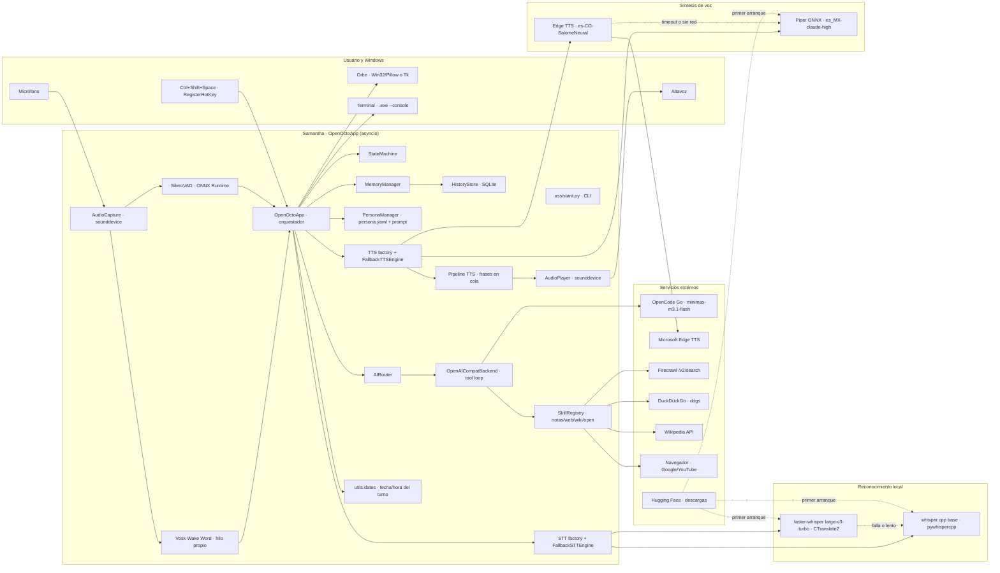
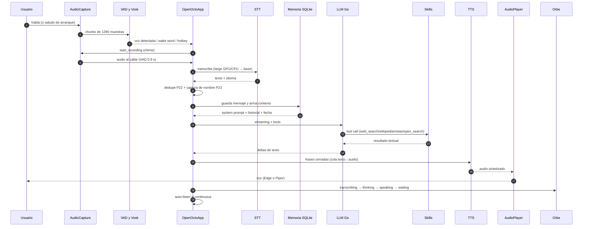
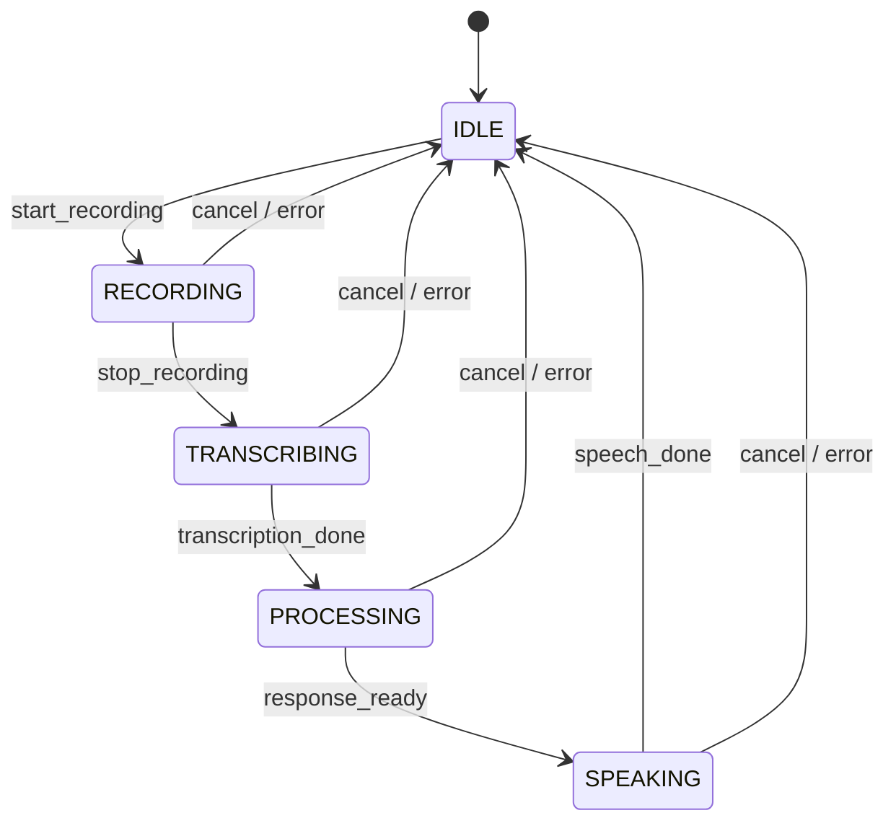
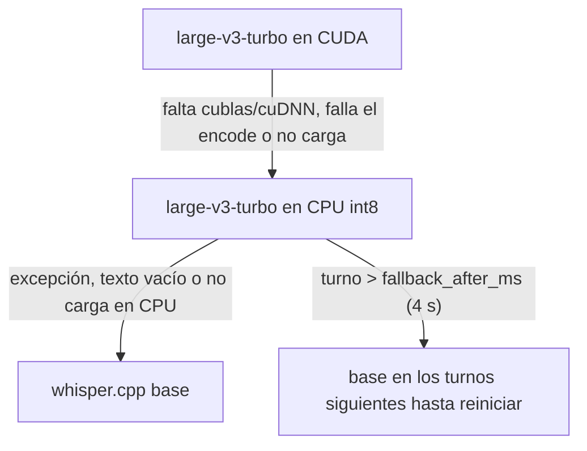

# AGENTS.md — Guía técnica de Samantha (OpenOcto)

Documento para futuros agentes/desarrolladores que toquen este repositorio.
Explica **qué hay, cómo se conecta, dónde se configura y cómo diagnosticar**.
La guía de uso está en [`README.md`](README.md); aquí va la ingeniería.

---

## 0. Reglas de trabajo en este repo

1. **No hacer commit, push ni reconstruir el `.exe` sin pedirlo.** El dueño
   compila; el árbol de trabajo puede estar sucio a propósito.
2. **Nunca imprimir ni pegar API keys.** Viven en `secret\` (gitignored). Para
   mostrarlas se usan longitud + huella SHA-256 (10 hex), como hace
   `assistant.py check`.
3. **No tocar `dist\` ni `models\` sin pedirlo.** Los builds y modelos pesan GB.
4. Los comentarios y la documentación van **en español**; el código mantiene
   nombres y APIs del upstream en inglés.
5. Antes de dar algo por terminado: `py_compile` de lo tocado y
   `python -m unittest discover -s tests -t .` (**116 pruebas**).
6. Si un cambio afecta una decisión grande (STT, TTS, LLM, build), anotarlo en
   `docs/specs/` con el formato de change spec ya usado.

---

## 1. Stack y versiones

| Pieza | Versión / detalle |
|---|---|
| Python | 3.12.8 en este equipo (soporta ≥3.10) |
| PyInstaller | 6.22.3 (`--onedir --windowed`) |
| pydantic | 2.x (config validada) |
| faster-whisper | 1.2.1 · CTranslate2 4.8.5 · av 19.0.2 · tokenizers 0.23.3 |
| pywhispercpp | 1.2.x (whisper.cpp, fallback) |
| onnxruntime | Silero VAD + Piper |
| edge-tts | 7.3.x (voz neuronal online) |
| piper-tts | 1.2.x (voz local) |
| vosk | 0.3.45 (wake word offline) |
| sounddevice | audio (PortAudio) |
| openai | cliente del backend compatible |
| ddgs | respaldo de búsqueda (scraper no oficial) |
| pillow | orbe con alfa por píxel |
| numpy | 2.x |

Dependencias declaradas en `pyproject.toml` (`[project].dependencies` y
`[project.optional-dependencies].audio`).

---

## 2. Mapa del repositorio

```
octo/
├─ assistant.py            CLI única: start/key/check/report/say/facts/orb
├─ assistant-config.yaml   fuente de verdad de la configuración efectiva
├─ build_portable.py       PyInstaller + staging + swap + modelos/keys/GPU
├─ pyproject.toml          paquete openocto-dev 0.1.1
├─ README.md               guía de usuario
├─ AGENTS.md               este documento
├─ config/default.yaml     defaults que se mezclan con el config del usuario
├─ personas/samantha/      persona.yaml + system_prompt.md
├─ secret/                 OPENCODE_GO_API_KEY · FIRECRAWL_API_KEY (gitignored)
├─ models/                 modelos locales en desarrollo (faster-whisper)
├─ docs/specs/             change specs (búsqueda, whisper grande, etc.)
├─ tests/                  suite unittest (116 pruebas)
├─ samples/                voces Piper de muestra (wav)
├─ tools/                  make_orb_icon.py
└─ openocto/
   ├─ app.py               orquestador del asistente (1.200+ líneas)
   ├─ config.py            modelos pydantic + rutas dev/portable
   ├─ state_machine.py     idle → recording → transcribing → processing → speaking
   ├─ history.py           SQLite (usuarios, mensajes, resúmenes, notas, hechos)
   ├─ memory.py            contexto enriquecido + resumen en segundo plano
   ├─ ai/                  router + backend OpenAI-compatible + tool loop
   ├─ audio/               captura y reproducción (sounddevice)
   ├─ stt/                 factory, faster-whisper, whisper.cpp, fallback
   ├─ tts/                 factory, edge, piper, fallback
   ├─ vad/                 Silero VAD ONNX
   ├─ wakeword/            Vosk “hola samantha”
   ├─ skills/              notas, web_search, wikipedia, open_search
   ├─ persona/             carga de personas
   ├─ ui/orb.py            orbe de estado (Win32 alfa / Tk fallback)
   └─ utils/               consola, fechas, hotkey, teclado, logging, modelos
```

---

## 3. Arquitectura general



**Lectura del diagrama**

- El audio nunca sale del PC; lo que viaja es **texto** (OpenCode Go, Firecrawl,
  Wikipedia) y, con Edge, el texto de las respuestas a Microsoft.
- `OpenOctoApp` es el único que habla con todos los componentes; los motores
  STT/TTS son sustituibles por configuración.
- El orbe y la terminal son consomos de estado: no participan del pipeline.
- Los modelos se descargan de Hugging Face (whisper.cpp/Piper/faster-whisper),
  GitHub (Silero) y alphacephei (Vosk) al primer uso.

---

## 4. Flujo de un turno



Puntos finos del pipeline (todos en `openocto/app.py`):

- **Saludo de arranque:** `_auto_greet()` espera `greet_delay`, llama
  `_inject_text()` que pausa Vosk, marca conversación, llama `orb.show()` y
  deja un `TranscriptionResult` sintético en `_pending_text`. `_handle_audio`
  lo consume en vez de transcribir.
- **Dedupe P22:** si el STT entrega la misma frase (ratio ≥ 0,90) en menos de
  6 s, el turno se descarta.
- **Nombre P23:** si no se conoce el nombre, el system prompt pide preguntarlo
  una vez; `utils/names.py` extrae el nombre dictado y lo guarda como hecho.
- **Fecha:** `_fecha_block()` añade `## Fecha y hora actuales` **en cada turno**
  con `datetime.now()` (nada quemado en el prompt ni en la persona).
- **Error-shaped responses:** si el “texto” del backend parece un error HTTP
  (`_looks_like_error_response`), no se lee en voz alta y se corta el turno.
- **Respuesta vacía:** si el modelo gasta el tope razonando y no devuelve texto,
  se dice una frase de recuperación (“Me quedé en blanco…”).
- **Barge-in:** una pulsación durante el habla corta el playback y aborta TTS
  (`_abort_tts`).

---

## 5. Máquina de estados



El saludo sintético pasa por `start_recording → stop_recording` sin abrir el
micrófono, para reutilizar exactamente la misma máquina y pipeline.

---

## 6. Cadena de fallback del STT



- `cuda\` junto al `.exe` + paquetes pip `nvidia-*-cu12` + `cuda_dll_dirs` se
  registran en `os.add_dll_directory` **y en `PATH`** (CTranslate2 usa
  `LoadLibrary` y solo ve `PATH`; `add_dll_directory` por sí solo no basta).
- Al cargar en GPU se hace un **warm-up** de 1 s de silencio: ahí se detecta si
  cuBLAS/cuDNN faltan y se recarga en CPU antes del primer turno real.
- `describe()` expone el motor real para el banner
  (`faster-whisper large-v3-turbo (GPU …) -> whisper.cpp base`).

---

## 7. Referencia por módulo

### `assistant.py` (CLI)

- Resuelve la key de OpenCode en este orden: `secret\OPENCODE_GO_API_KEY` →
  `secret\.env`/`.env` → variable de entorno → `HKCU\Environment`.
- Auto-relanza contra `.venv` con `os.execv` si hace falta.
- En el `.exe`: `--console`/`--terminal` se quitan de `argv` antes de argparse;
  `start` sin flag no muestra consola; `key/check/report/say/facts/orb/--help`
  se adjuntan a la consola (`AttachConsole`) o crean una (`AllocConsole`).
- `key firecrawl` guarda `secret\FIRECRAWL_API_KEY`.
- `check` valida: archivo de OpenCode, ping real (`health_check`) y **formato**
  de Firecrawl (`fc-…`), marcando `MAL` + AVISO si no corresponde.
- `report` parsea `logs\assistant.log` y muestra latencias por turno.
- Lock de instancia única: `USER_CONFIG_DIR/samantha.lock` (`msvcrt`/`fcntl`).

### `openocto/config.py`

Modelos pydantic y rutas. En modo **portable** (`sys.frozen` o
`OCTO_PORTABLE=1`), todo lo escribible vive junto al `.exe`:
`data/`, `models/`, `personas/`; en desarrollo usa `~/.openocto` (excepto
`personas/` y `config/default.yaml`, que salen del repo).

Merge de configuración: `config/default.yaml` → config de usuario →
`assistant-config.yaml` (CLI) → `${ENV_VAR}` resueltas en strings.

### `openocto/app.py`

Orquestador. Responsabilidades:

- Ciclo de activación: hotkey (`utils/keyboard.py`), Vosk, VAD, auto-listen.
- `_init_components()`: crea STT (factory), persona, TTS por idioma, AIRouter,
  skills, memoria.
- `run()`: resuelve usuario, health check del backend, banner, arranca orbe,
  wake word y hotkey, agenda saludo y entra en el bucle asyncio.
- Turno: `_stop_recording → _handle_audio →` (transcripción) `→` memoria +
  fecha + LLM streaming + TTS por frases + auto-listen.
- `_inject_text` + `_auto_greet`: saludo de arranque sin micrófono.
- TTS: `_start_tts_pipeline`, `_tts_synth_worker`, `_tts_play_worker`,
  `_finish_tts`; síntesis y reproducción en paralelo.
- Errores: `_friendly_error`, supresión de respuestas con forma de error.

### `openocto/state_machine.py`

Transiciones estrictas; un trigger inválido lanza `InvalidTransitionError`.
`reset()` vuelve a IDLE para recuperación.

### `openocto/ai/`

- `router.py`: elige backend (`default_backend`), hace health check y enruta
  `send_streaming`.
- `openai_compat.py`: cliente OpenAI-compatible; `send()` sin tools para
  memoria/health; `send_streaming` con tool loop.
  - `_MAX_TOOL_ITERATIONS = 6`, `_MAX_RESEARCH_CALLS = 2`
    (`web_search` + `wikipedia`); al agotar el presupuesto se fuerza una
    respuesta final **sin tools**.
  - `_sanitize_messages` elimina `id`/`created_at` (algunos modelos dan 400).
  - `reasoning_effort` y `extra_body` configurables por proveedor.
  - Timeout de turno `ai.turn_timeout`; cliente 120 s para lo no interactivo.

### `openocto/stt/`

- `factory.py`: `engine` (`faster_whisper`/`whisper_cpp`) + `fallback_engine`.
  Si el primario no carga, cae al fallback como principal.
- `faster_whisper.py`: `large-v3-turbo`; `device=auto` → CUDA con warm-up;
  falla → CPU int8; registra DLLs de CUDA; describe el estado real.
- `whisper_cpp.py`: motor clásico (`pywhispercpp`), hotwords como
  `initial_prompt`, filtra alucinaciones típicas.
- `fallback.py`: usa el fallback si el primario lanza, devuelve vacío o supera
  `fallback_after_ms` (y se queda ahí hasta reiniciar).

### `openocto/tts/`

- `factory.py`: por idioma (`engines[lang]` o `engine`); Edge + fallback.
- `edge.py`: `edge-tts`, 24 kHz, voz por idioma, `rate/pitch/volume`,
  `timeout`, recorte de silencio (`trim_silence`), recorte de cola.
- `piper.py`: API Python (`PiperVoice`) y CLI como respaldo; en `.exe`
  `CREATE_NO_WINDOW` para no abrir consolas fantasma.
- `fallback.py`: tras un fallo usa Piper durante `fallback_cooldown` y luego
  reintenta Edge.

### `openocto/vad/silero.py`

ONNX en CPU; soporta v4 (h/c) y v5 (state). Puerta rápida por RMS
(`rms_speech_threshold`) y decisión final por probabilidad
(`threshold`). Histéresis de 2 chunks para no alargar la toma por un pico.

### `openocto/wakeword/vosk_detector.py`

Vosk en hilo propio; normaliza texto (sin tildes) y compara palabras con
`difflib` (umbral 0,82). `WakeWordController` pausa/reanuda para no
auto-despertarse. El callback llega al loop con `call_soon_threadsafe`.

### `openocto/audio/`

- `capture.py`: `sounddevice.InputStream`, mono 16 kHz, bloque 1280; resuelve
  dispositivo por índice o subcadena y cae al predeterminado si falla; ganancia
  y normalización; `wait_ready()` para micros lentos; stream caliente entre
  turnos. Con `input_device: null` **sigue el predeterminado de Windows**:
  un watchdog cada 0,5 s reabre el stream si el default cambia de índice o si
  pasan 2,5 s sin chunks (audífonos desconectados, Bluetooth caído).
- `player.py`: `OutputStream`, fundidos, limitador suave con `gain`, chimes de
  dos notas.

### `openocto/skills/`

- `base.py`: `Skill` + `SkillRegistry`; esquema JSON para tools OpenAI;
  `SkillUnavailable` desactiva una skill sin romper el arranque; `SkillError`
  se devuelve al LLM como `Error: …`.
- `notes.py`: crear/listar/resolver notas y hechos (contexto de usuario).
- `web_search.py`: Firecrawl (`/v2/search`); ante `401` **y** `402` cae a
  DuckDuckGo (`ddgs`, `co-es`); devuelve texto listo para el LLM.
- `wikipedia.py`: API pública, resumen en español.
- `open_search.py`: solo Google/YouTube, sin URLs arbitrarias.

### `openocto/memory.py` + `history.py`

- `HistoryStore` (SQLite): tablas `users`, `user_identities`, `messages`,
  `conversation_summaries`, `conversation_notes`, `user_facts`.
- `build_context` = prompt de persona + hechos + notas activas + último
  resumen + ventana reciente (`recent_window`).
- `maybe_process` resume en segundo plano al superar
  `summarize_threshold` mensajes sin resumir.

### `openocto/persona/`

Carga `personas/<nombre>/persona.yaml` y `system_prompt.md`. La persona
`persona.yaml` define `name`, `display_name`, `description`.

### `openocto/ui/orb.py`

Ventana en hilo propio. Intenta `_VentanaAlfa` (Win32 layered + Pillow, alfa
por píxel, DPI-aware); si falta Pillow o falla, usa `_Ventana` (Tk). Acciones
por cola: `show`, `state`, `end`, `close`. **`state` no hace visible la
ventana: solo `show`.** Cualquier camino nuevo de conversación debe llamar
`orb.show()` (ver runbook). El cuerpo es plano (sin brillo interior) y lleva un
infinito crema centrado (`puntos_simbolo`, lemniscata de Gerono); los efectos
por estado se dibujan por fuera.

### `openocto/utils/`

`console` (colores), `dates` (fecha/hora es), `hotkey` (parseo del combo),
`keyboard` (RegisterHotKey en VAD, pynput en hold), `logging_setup`
(archivo DEBUG + consola WARNING), `model_downloader` (descargas HF/Vosk),
`names` (extracción del nombre dictado), `icons`.

---

## 8. Configuración

`assistant-config.yaml` es la fuente efectiva (el build la copia al portable).
Secciones y claves relevantes:

| Sección | Claves |
|---|---|
| `audio` | `input_device`, `output_device`, `sample_rate`, `blocksize`, `mic_gain`, `normalize`, `ptt_mode` (`vad`/`hold`), `ptt_hotkey`, `continuous`, `continuous_tail_guard` |
| `vad` | `threshold`, `silence_duration`, `rms_speech_threshold`, `no_speech_timeout`, `max_recording_duration` |
| `wakeword` | `enabled`, `phrase`, `model`, `greet_on_start`, `greet_text`, `greet_delay` |
| `stt` | `engine`, `fallback_engine`, `fallback_after_ms`, `model_size`, `language`, `n_threads`, `hotwords`, `faster_whisper.*` |
| `tts` | `engine`, `engines`, `edge.*`, `fallback_engine`, `fallback_cooldown`, `models`, `gain`, `length_scale`, `sentence_silence` |
| `ai` | `default_backend`, `providers.<n>.{api_key,model,base_url,headers,no_auth,reasoning_effort,extra_body}`, `max_history`, `turn_timeout`, `max_tokens` |
| `memory` | `enabled`, `recent_window`, `summarize_threshold`, `max_facts`, `max_notes`, `notes_ttl_days` |
| `skills` | `enabled[]`, `firecrawl.{timeout,max_results,lang,country,fallback,region}` |
| `ui` | `orb` |
| `logging` | `level` (archivo), `console_level`, `file`, `max_bytes`, `backup_count` |

Notas que ya costaron debugging:

- MiniMax M3.1 Flash: `reasoning_effort` acepta `low|medium|high|xhigh|max`.
  `none|auto|adaptive` → HTTP 400 (`reasoning effort … is not allowed`).
  Con `high` hay que subir `max_tokens` (4000) o la respuesta sale vacía.
  Cada modelo publica su propia escalera (algunos no publican ninguna) en
  `GET /inference/go/v1/models` → `data[].capabilities.reasoning.effort`.
  Todos los modelos de texto la declaran con `supported: true`.
- `rms_speech_threshold: 300` con micro lejano hacía que ni llegara a Silero;
  el valor actual es **50**.
- `stt.hotwords` se inyecta como `initial_prompt`; corrige nombres propios
  (“Freddy” → “Fredy”, “Bogotá”).
- `model_size` es el modelo del **fallback whisper.cpp**, no el grande.
- La fecha/hora **no** se configura: se calcula por turno (`utils/dates.py`).

---

## 9. Rutas y persistencia

| Dato | Desarrollo | Portable |
|---|---|---|
| Config | `octo\assistant-config.yaml` | `<app>\assistant-config.yaml` |
| Config de usuario | `~\.openocto\config.yaml` | `<app>\data\config.yaml` |
| SQLite | `~\.openocto\history.db` | `<app>\data\history.db` |
| Modelos | `~\.openocto\models\` + `octo\models\faster-whisper` | `<app>\models\` |
| Personas | `octo\personas\` | `<app>\personas\` |
| Logs | `octo\logs\assistant.log` | `<app>\logs\assistant.log` |
| Secretos | `octo\secret\` | `<app>\secret\` |
| Lock | `~\.openocto\samantha.lock` | `<app>\data\samantha.lock` |

Descargas (primer uso):

- whisper.cpp: `huggingface.co/ggerganov/whisper.cpp` (`ggml-<size>.bin`).
- faster-whisper: `mobiuslabsgmbh/faster-whisper-large-v3-turbo` (redirige a
  `dropbox-dash/...`), cache HF en `models/faster-whisper`.
- Piper: `huggingface.co/rhasspy/piper-voices` (`es_MX-claude-high`).
- Silero VAD: repo `snakers4/silero-vad` (`silero_vad.onnx`, ~1,7 MB).
- Vosk: `alphacephei.com/vosk/models/vosk-model-small-es-0.42.zip`.

---

## 10. Build portable (`build_portable.py`)

Pasos reales:

1. Verifica `.venv` (instala PyInstaller si falta).
2. Limpia/crea `dist\_stage_Samantha` (o `<distpath>\_stage_Samantha`).
3. Genera icono si falta (`tools/make_orb_icon.py`).
4. PyInstaller `--onedir --windowed --clean` con:
   - `--collect-all`: onnxruntime, piper, sounddevice, `_sounddevice_data`,
     pywhispercpp, edge_tts, miniaudio, PIL, vosk, ddgs, faster_whisper,
     ctranslate2, av, tokenizers, huggingface_hub.
   - `--hidden-import` de todos los módulos openocto + dependencias.
   - DLLs `whisper-*.dll` y `ggml-*.dll` de site-packages.
5. Copia `personas\` y `assistant-config.yaml`.
6. Copia modelos: whisper.cpp del fallback, voces Piper, Silero, Vosk y
   `models\faster-whisper` (o el del `dist` anterior).
7. `--gpu`: copia `nvidia\**\*.dll` a `cuda\` (cublas/cudnn/nvrtc).
8. `--with-key`: copia OpenCode **y** Firecrawl a `secret\`.
9. Escribe `LEEME.txt`.
10. Conserva `data`, `logs`, `secret` y el config anterior
    (`assistant-config.previous.yaml`).
11. **Swap con rename** (`_rename_retry`): si el destino está abierto, falla
    antes de borrar nada; la build queda en `_stage_Samantha\Samantha`.

Tamaños medidos: **2.280 MB** sin `--gpu` (con large y modelos) y
**4.228 MB** con `--gpu` (cuda: 1.948 MB; faster-whisper: 1.547 MB).

### Verificar que un `.exe` contiene un fix (sonda del PYZ)

```python
# python - del venv; requiere PyInstaller instalado
import io, os, sys, dis, tempfile
from PyInstaller.archive.readers import CArchiveReader, ZlibArchiveReader
exe = r"C:\SamanthaBuild\Samantha\Samantha.exe"
r = CArchiveReader(exe)
name = [n for n in r.toc if str(n).lower().startswith("pyz")][0]
data = r.extract(name)
tmp = os.path.join(tempfile.gettempdir(), "probe_PYZ.pyz")
open(tmp, "wb").write(data)
code = ZlibArchiveReader(tmp).extract("openocto.app")

def find_fn(c, target):
    if c.co_name == target:
        return c
    for k in c.co_consts:
        if hasattr(k, "co_names"):
            f = find_fn(k, target)
            if f:
                return f

fn = find_fn(code, "_inject_text")
ops = [i.argrepr for i in dis.get_instructions(fn)
       if i.opname in ("LOAD_METHOD", "LOAD_ATTR")]
print("show en _inject_text:", "show" in ops)
```

> **Importante:** el `mtime` del `.exe` no prueba qué código lleva. PyInstaller
> analiza los `.py` al principio y escribe el exe al final; un build lanzado
> antes de un cambio puede terminar después y no incluirlo. Usa la sonda.

---

## 11. Pruebas

```powershell
.\.venv\Scripts\python.exe -m unittest discover -s tests -t .
# Ran 116 tests in ~2 s ... OK
```

| Archivo | Cubre |
|---|---|
| `test_stt_faster.py` | large en CUDA/CPU, warm-up, fallback, latency, describe |
| `test_web_search.py` | Firecrawl 401/402 → DDG, límites, errores |
| `test_greet.py` | `_inject_text`, `_auto_greet`, orb.show, config |
| `test_dates.py` | `fecha_es`/`hora_es` y `_fecha_block` |
| `test_orb.py` | geometría, símbolo y estados del orbe |
| `test_llm.py` | presupuesto de 2 búsquedas y respuesta final |
| `test_router.py` | el mensaje actual no viaja dos veces al modelo |
| `test_cli.py` | `--console` y comando por defecto |
| `test_hotkey.py`, `test_teclas.py`, `test_audio_texto.py`, `test_memoria.py`, `test_historial.py` | utilidades y memoria |

Los tests no descargan el modelo grande ni abren micrófono.

---

## 12. Runbook de problemas

### 12.1 “faster-whisper CUDA no operativo (cublas64_12.dll)”

- **Causa:** driver NVIDIA sí, pero faltan cuBLAS/cuDNN (no vienen con Windows
  ni con el driver).
- **Solución dev:** `pip install nvidia-cublas-cu12 nvidia-cudnn-cu12`.
- **Solución portable:** compilar con `--gpu` (copia las DLLs a `cuda\`).
- El motor registra las carpetas en `PATH` (CTranslate2 usa `LoadLibrary`;
  `add_dll_directory` solo no le llega) y hace warm-up; si falla, CPU int8.
- **Comprobar:** banner `oído faster-whisper large-v3-turbo (GPU …)`; en el log
  `faster-whisper loaded: … (device=cuda)`. Sin eso, está en CPU.

### 12.2 Firecrawl: “error de acceso” / 401

- La key guardada debe empezar por **`fc-`**. `assistant.py check` la marca
  `MAL` si no; una key de 13 chars tipo `b10…` es inválida (probado en vivo:
  `401 {"error":"Unauthorized: Invalid token"}`).
- Reponer con `assistant.py key firecrawl` (o `Samantha.exe key firecrawl`) y
  recompilar con `--with-key` para el portable.
- **401 y 402** caen a DuckDuckGo (`ddgs`); si también falla, el LLM recibe un
  `Error:` y debe decirlo, no inventar.

### 12.3 Fecha/hora incorrecta o “la busco en la web”

- Debe existir `## Fecha y hora actuales` en el prompt de cada turno
  (`_fecha_block`) y la regla `## Fecha` en la persona.
- **No** agregar fechas literales en `system_prompt.md` ni en el prompt: el
  bloque es dinámico y se recalcula por turno.
- Si el `.exe` es viejo, no trae la inyección; recompilar.

### 12.4 El orbe no aparece al saludar (o en un camino nuevo)

- `OrbController.show()` es **lo único** que hace visible la ventana;
  `state()` solo cambia el estado.
- Al arrancar, `OpenOctoApp.run()` llama `_show_orb_at_start()` (start +
  `state("waiting")` + show) **antes** de `_init_components()`: el orbe gris
  aparece de inmediato mientras cargan whisper/Piper. Si se reordena el
  arranque, mantener esa llamada primero (lo cubre `test_greet.py`).
- El saludo (`_inject_text`) debe llamar `show()` antes del turno. Cualquier
  camino nuevo de conversación también.
- Verifica `ui.orb: true`. Y que el exe sea posterior al fix (sonda §10).

### 12.5 El build muere con `WinError 1392/145` en `_stage_Samantha`

- **Causa:** volumen exFAT con corrupción de directorios (común en discos
  externos; este proyecto vive en `E:`). `fsutil dirty query E:` responde
  “El volumen contiene errores”.
- `rd /s /q` y `robocopy /MIR` no lo arreglan; **no insistas**.
- `chkdsk E: /f` como administrador (cerrar Samantha/Explorer) y reintentar.
- Mientras tanto: `build_portable.py --gpu --with-key --distpath
  C:\SamanthaBuild` (el Micron interno está sano).
- No es un bug del script: el staging es intencional para no perder el exe
  bueno si el build falla.

### 12.6 No puedo reemplazar `dist\Samantha`

- La carpeta está abierta/bloqueada. El script falla **antes** de borrar y deja
  la build nueva en `_stage_Samantha\Samantha`; ciérrala y vuelve a ejecutar.

### 12.7 Doble instancia / no se adjunta la consola

- Lock en `samantha.lock`; la segunda instancia solo avisa. `--console` no se
  adjunta a una instancia ya corriendo.

### 12.8 Edge TTS cae a Piper

- Sin red o `timeout` (10 s). El aviso `edge no disponible (TimeoutError…)` es
  normal; esa frase se dice con Piper y Edge se reintenta tras
  `fallback_cooldown` (30 s). No es un error fatal.

### 12.9 Respuesta vacía del LLM

- Modelos que razonan consumen `max_tokens` pensando. Subir `ai.max_tokens`
  (4000 actual) o bajar `reasoning_effort` a `low` para voz.

### 12.10 El modelo encadena 5–6 búsquedas

- Ya está limitado: `_MAX_RESEARCH_CALLS = 2` (web_search + wikipedia) y luego
  `_final_answer` sin tools. Si vuelve a pasar, revisar que el modelo no llame
  herramientas que no sean de investigación (no cuentan al presupuesto).

### 12.11 El nombre no se guarda

- `_captura_nombre` usa `utils/names.py`; solo actúa si `_name_unknown`.
  Revisa el prompt P23 y que el STT haya transcrito “me llamo/soy …”.

### 12.12 Se perdió la primera sílaba (Bluetooth/MME)

- El stream se calienta y el chime suena antes de grabar; si hablas antes del
  chime se pierde. En continuo el stream queda caliente entre turnos.

### 12.13 Ver latencia real

- `assistant.py report` (o `Samantha.exe report`): lee el log y muestra
  STT/LLM/TTS por turno. Útil para decidir `beam_size`, GPU o el fallback por
  latencia.

### 12.14 La IA dice que la escuchas doble / que repites lo mismo

- **Causa típica:** el turno actual viajaba dos veces al modelo. `app.py`
  guardaba el mensaje del usuario **antes** de `build_context`, el historial ya
  lo incluía y `AIRouter.send_streaming` lo volvía a añadir como mensaje actual.
  Se notaba sobre todo al arrancar (turno del saludo).
- **Corregido:** el contexto se construye antes de persistir el mensaje y el
  router descarta el último mensaje del historial si es idéntico al actual
  (`test_router.py`).
- Si lo que se duplica es el **audio** (dos voces), revisa eco del TTS,
  `continuous_tail_guard` y que Vosk esté pausado durante playback; no es este
  caso.

### 12.15 La asistente lee “barra think” / el log no registra la respuesta

- **Causa:** MiniMax M3.1 manda normalmente el razonamiento en
  `delta.reasoning_content` (que el backend ignora), pero a veces filtra las
  etiquetas de pensamiento dentro de `delta.content`. Como no había filtro, la
  etiqueta de cierre llegaba al TTS y Edge la pronunciaba literalmente
  (“barra think”). El log no registraba la respuesta porque el camino real de
  cada turno (`_tool_loop`, siempre que hay skills) nunca logueaba el texto y
  el camino sin tools solo logueaba la longitud.
- **Corregido:** `_ThinkScrubber` en `openai_compat.py` elimina los bloques de
  razonamiento del stream (etiquetas partidas entre deltas, cierre huérfano y
  variante `<thinking>`), cableado en `send`, `send_streaming`, `_tool_loop` y
  `_final_answer`. Cada turno deja una línea INFO
  `go respuesta del turno (N chars): …` (texto truncado a 500). El debug de
  RMS del VAD se limita a 1 línea/s para no pudrir el log.
- **Verificar:** `tests/test_llm.py` (clase `ThinkScrubberTest`) y, tras un
  turno real, `logs\assistant.log` debe contener la línea
  `respuesta del turno`.

### 12.16 Deja de escuchar al desconectar los audífonos

- **Causa:** el stream de PortAudio queda atado al dispositivo que se abrió.
  En conversación continua (o con wake word) se mantiene caliente entre turnos,
  así que al desconectar los audífonos el índice viejo deja de entregar chunks
  y Samantha "no oye" aunque ya uses otro micrófono.
- **Corregido:** con `audio.input_device: null` se consulta el predeterminado
  de Windows en cada apertura y un watchdog (`openocto/audio/capture.py`,
  `_check_stream_health`) reabre el stream si: cambia el índice predeterminado
  o pasan 2,5 s sin callbacks. Si había un dispositivo fijado por nombre/índice
  y desaparece, cae al predeterminado y lo sigue desde ahí.
- **Verificar:** `tests/test_audio_device.py`; en vivo, desconectar los
  audífonos y ver en el log `Micrófono predeterminado cambió (#x → #y)` o
  `Sin audio del micrófono…` seguido de `Micrófono reabierto`.

---

## 13. Invariantes y decisiones

- **Solo terminal**: sin UI web, sin servidor HTTP, sin MCP. El orbe es una
  ventana de estado, no una UI de chat.
- **Audio local**: STT/VAD/wake word corren en el equipo; a la nube solo va
  texto (LLM/Firecrawl/Wikipedia) y, con Edge, el texto a Microsoft.
- **Portable autocontenido**: `Samantha.exe` + `_internal` + modelos + config;
  `data`, `logs` y `secret` sobreviven a los rebuilds.
- **Claves nunca se imprimen**: solo longitud/huella.
- **Fallbacks en cascada** (no bloquear la conversación): GPU→CPU→whisper.cpp;
  Edge→Piper; Firecrawl→DuckDuckGo; LLM sin tools al agotar investigación.
- **El prompt no lleva fechas quemadas**; el bloque de fecha es dinámico.
- **Degradación silenciosa pero visible en logs**: si el orbe, skills o wake
  word no cargan, la app sigue y lo advierte.

---

## 14. Deuda técnica / próximos pasos

- Reponer la key real de Firecrawl (`fc-…`).
- `chkdsk E: /f` al volumen exFAT (la build en `E:` depende de eso).
- No hay bandeja del sistema ni `--stop`; para cerrar en segundo plano hay que
  usar el Administrador de tareas.
- El resumen de memoria y la extracción de hechos dependen del LLM; si el
  backend falla, no se actualizan.
- DuckDuckGo es un scraper no oficial (CAPTCHA/límite); una API oficial
  (Brave Search) sería más estable.
- `openocto/__main__.py` conserva el CLI upstream (click) con comandos de
  usuarios/micrófono; la entrada real de Samantha es `assistant.py`.

